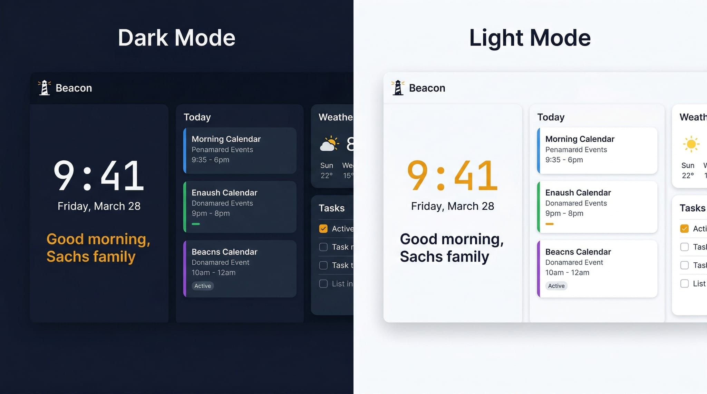

<p align="center">
  
</p>

<h3 align="center">Your family's daily signal</h3>

<p align="center">
  <a href="https://my.home-assistant.io/redirect/supervisor_add_addon_repository/?repository_url=https%3A%2F%2Fgithub.com%2Fasachs01%2Fbeacon"></a>
</p>

<p align="center">
  <a href="LICENSE"></a>
  <a href="https://github.com/asachs01/beacon/releases"></a>
  <a href="https://github.com/asachs01/beacon/stargazers"></a>
  <a href="https://github.com/sponsors/asachs01"></a>
  <a href="https://buymeacoffee.com/aaronsachs"></a>
</p>

<p align="center">
  Beacon is a free, open-source family command center for wall-mounted displays. It runs as a Home Assistant add-on or standalone — turn any tablet or spare screen into a beautiful family dashboard with no subscription fees and no cloud dependency.
</p>

<p align="center">
  
</p>

---

## Skylight alternative — without the subscription

Skylight is a polished wall calendar that charges for hardware **and** locks meal planning, photos, and other family features behind Calendar Plus (~$79/year). Beacon is the self-hosted answer: run it as a Home Assistant add-on (or standalone), keep data on your network, and use any tablet you already own.

→ [Getting started](https://beaconfamily.app/docs/getting-started/welcome/) · [Beacon vs Skylight](https://beaconfamily.app/docs/getting-started/skylight-alternative/) · [Android app](https://beaconfamily.app/docs/getting-started/android/) · Install with the Home Assistant badge above

**Beacon is the free, MIT-licensed family command center that installs as a Home Assistant add-on in one click — open source all the way down, running in any tablet's browser or as a signed Android app, in your language.**

> **Looking at other self-hosted options?** [Kinboard](https://kinboard.app) is a self-hosted family dashboard with doorbell popups and "today" hints. It runs on Docker with Postgres and is free for noncommercial use under the [PolyForm Noncommercial license](https://github.com/svenger87/kinboard#license). Beacon is MIT-licensed, installs as a one-click Home Assistant add-on, and ships in nine languages. Pick the one that fits your setup.

## Features

- **Weekly Calendar** -- Beautiful week view with color-coded family members; supports HA calendar entities and a built-in local calendar
- **Grocery & Shopping Lists** -- AnyList, Home Assistant Shopping List, and local list support
- **Grocy** ([docs](https://beaconfamily.app/docs/features/grocery/), [v1.52.0](https://github.com/asachs01/beacon/releases/tag/v1.52.0)) -- Optional, through the [HACS Grocy integration](https://github.com/custom-components/grocy), under Settings → Integrations → Grocy. Magic Import can add items to Grocy's shopping list (`add_generic`). Optional expiring-products and low-stock cards (off by default) read `binary_sensor.grocy_expiring_products` and `binary_sensor.grocy_missing_products`. From 1.52.1, with Grocy Integration on, the Grocery screen includes a list named Grocy and check-offs on that list write the shopping-list done flag. The expiring card shows only items due within 3 days.
- **Home sensors** ([docs](https://beaconfamily.app/docs/features/home-sensors/), [v1.53.0](https://github.com/asachs01/beacon/releases/tag/v1.53.0)) -- Off by default. Pick entities under Settings → Integrations (each can have a friendly name and icon), then add the card in dashboard edit mode. It is not in the Family, Classic, or Compact layouts. Values update live over the Home Assistant websocket, with no polling. If an entity is unavailable, unknown, or hasn't updated in 3 hours, the card shows "Unavailable", "Unknown", or "No update in 3 h" instead of a stale value. The card shows only the entities you pick, and it excludes cameras. The card is read-only: it does not toggle devices, call services, or show camera feeds. The `/beacon-ws/ha` server connection only passes `get_states`, `state_changed` subscriptions, `unsubscribe_events` for subscriptions it opened, and `ping`; other commands are refused. Hidden from guests and Kid Display. Works with the add-on and standalone (`HA_URL`/`HA_TOKEN`).
- **Task / Todo Lists** -- Home Assistant todo entities and local task lists with dashboard integration
- **Chore Tracking** -- Assign chores, track streaks, and celebrate completions with a family leaderboard
- **Chore-gated privileges** -- Optionally bind a child's chores to a Home Assistant switch, input_boolean, light, or fan. Beacon turns it on when they finish today's chores, and off when a chore is unchecked, at the chore reset time (local midnight when that time is unset), and when Beacon restarts. The add-on also fires `beacon_chore_completed` and `beacon_all_chores_done` events for your own automations.
- **Press-to-talk** -- Hold a mic button on the wall to talk to Home Assistant Assist. Phrases like "I finished X" complete that chore in Beacon's chore chart. The microphone needs HTTPS or localhost (a plain-HTTP kiosk keeps a text box). Nothing listens until you hold the button, and there is no wake word.
- **Magic Import** ([docs](https://beaconfamily.app/docs/features/magic-import/), [v1.49.0](https://github.com/asachs01/beacon/releases/tag/v1.49.0)) -- Paste a school email or other text, or add one photo or PDF (JPEG, PNG, HEIC where the browser can convert it, or PDF; 10 MB). Review the draft events and list items, and approve them with the family PIN. Pasted text, and a PDF with real text (read in the browser, first 5 pages), is processed by your Home Assistant conversation agent, or a local parser. If that agent is a cloud service (OpenAI, Google, or Anthropic), Home Assistant sends the text to that provider. Only photos and scanned PDFs (page 1 of a scan) need the Home Assistant AI Task entity you pick in Settings → Display → Magic Import: AI Task entity for photos (Home Assistant 2025.8 or newer). The local parser can't read images, and a failed photo read does not fall back to it. Beacon does not write the file to its own /data; it briefly uploads it to Home Assistant's local media source for the task and deletes it afterward. A cloud AI Task sends the file to that provider.
- **Music Controls** -- Control Music Assistant, Home Assistant media players, and browse playlists from the display
- **Photo Slideshow** -- Display family photos between interactions
- **Timer / Countdown** -- On-screen timer for cooking, homework, and more
- **Screen Saver** -- Automatic screen saver with clock overlay
- **Night mode** ([docs](https://beaconfamily.app/docs/features/night-mode/), [v1.50.0](https://github.com/asachs01/beacon/releases/tag/v1.50.0)) -- Off by default under Settings → Display → Night mode. You can set a schedule (default 9:00 PM to 6:30 AM, overnight ranges work, device local time) or turn it on or off manually. While it is on, Beacon switches to the Midnight theme, adds a dim layer (default 30%), and can show an optional clock-only screen. A tap removes the dim layer and the clock-only screen for 60 seconds, so the dashboard is back at full brightness, still in the Midnight theme. The dimming is a web overlay; it does not change the device's screen brightness. A finished countdown timer wakes the screen and holds it until the alarm is dismissed. Night mode also runs on the Kid Display and kiosk views when it is turned on.
- **Weather** -- Real-time weather from your Home Assistant weather entity
- **8+ Themes** -- Skylight, Midnight, Midnight Light, Nord, Dracula, Monokai, Rose, Forest, and dark mode (automatic or manual)
- **Custom Fonts** -- Choose separate heading and body typefaces: bundled faces (including dyslexia-friendly Atkinson Hyperlegible and rounded Nunito), a Google Fonts family name, or an uploaded `.woff2`. Built-in and uploaded fonts work offline.
- **Family Management** -- Per-member colors, calendar filtering, and PIN-based profiles
- **Guest mode** ([docs](https://beaconfamily.app/docs/features/guest-mode/), [v1.51.0](https://github.com/asachs01/beacon/releases/tag/v1.51.0)) -- Optional guest PIN, empty by default, under Settings → Display → Guest mode. A guest enters with the corner gesture plus that PIN, and a Guest badge stays on the screen. Guests can view the calendar, check off chores, add to the grocery list, and use timers. They can view events but cannot create, edit, or delete them, and they cannot change settings or approve imports. What is hidden is a deny-list: whereabouts features (presence and location) and calendars marked Hide from guests are hidden; meals, photos, music, and the leaderboard stay visible. Guest check-offs on a family member's chore earn points and streaks and show "Checked off by Guest" on chore rows (the Chores screen, and completed chore rows on the dashboard and calendar task lists). Home Assistant to-do items don't get the label. From [v1.52.0](https://github.com/asachs01/beacon/releases/tag/v1.52.0), an unassigned guest check-off is recorded as Guest and earns no points. Guests can earn rewards but cannot redeem them. A session ends with the family PIN, the guest PIN when no family PIN is set, the timeout (default 4 hours), or when the guest PIN is cleared or changed. Leaving kiosk or Kid Display is a separate step. Guest mode is not a security boundary: it only limits what this Beacon screen shows.
- **Meal planner** ([docs](https://beaconfamily.app/docs/features/meals/), [v1.48.0](https://github.com/asachs01/beacon/releases/tag/v1.48.0)) -- Plan breakfast, lunch, dinner, and snacks on a week grid (it follows Settings → General → Week Starts On), or edit today's meals from the dashboard Menu card (it also shows on empty days). Meals can use a Beacon recipe; Add ingredients to grocery list writes to the default list or the built-in Shopping List, including Home Assistant to-do lists, not Grocy. The MCP tool `beacon_set_meal_plan` merges by default; a null or empty name clears one slot, and `replace: true` restores the old replace-everything behavior.
- **Standalone Mode** -- Works without Home Assistant using local calendars, lists, and tasks

## Installation

### Home Assistant Add-on (Recommended)

The fastest way to get started is the one-click button:

[](https://my.home-assistant.io/redirect/supervisor_add_addon_repository/?repository_url=https%3A%2F%2Fgithub.com%2Fasachs01%2Fbeacon)

Or install manually:

1. In Home Assistant, go to **Settings > Add-ons > Add-on Store**
2. Click the overflow menu (**...**) and select **Repositories**
3. Add: `https://github.com/asachs01/beacon`
4. Find **Beacon** in the store and click **Install**
5. Start the add-on and click **Open Web UI**

> **Tip:** For the best experience on a wall-mounted tablet, enable **Show in sidebar** in the add-on's Info tab so Beacon is one tap away.

### Standalone / Development

```bash
git clone https://github.com/asachs01/beacon.git
cd beacon
npm install
npm run dev
```

Open [http://localhost:5173](http://localhost:5173) in your browser. Beacon works fully without Home Assistant — calendars, lists, and tasks are stored locally in the browser.

From [v1.50.1](https://github.com/asachs01/beacon/releases/tag/v1.50.1), a standalone Docker container can also connect to Home Assistant when you set `HA_URL` (the base address, with no `/api`) and `HA_TOKEN` (a long-lived access token). Do not set `SUPERVISOR_TOKEN` in that mode. See the [deployment guide](https://beaconfamily.app/docs/getting-started/deployment/).

From [v1.54.0](https://github.com/asachs01/beacon/releases/tag/v1.54.0), a device that opens Beacon directly on its port (Docker, standalone, or a hand-mapped add-on port) pairs once with the family PIN or a 6-digit code. Opening Beacon from the Home Assistant sidebar, and the Android app's built-in dashboard, do not pair. `HA_BROWSER_TOKEN` is ignored. Automations and `rest_command`s send `Authorization: !secret beacon_token` (the add-on writes it to `secrets.yaml` automatically; on standalone, create one under Settings → Devices → Create access token and add it before restarting Home Assistant). Settings → Devices has Rotate pairing code. From [v1.54.3](https://github.com/asachs01/beacon/releases/tag/v1.54.3), the public `runtime-config.js` file contains the family name, theme, and auto dark mode setting; it never contains a token. Update to [v1.54.3](https://github.com/asachs01/beacon/releases/tag/v1.54.3) or later. Advisory: [GHSA-rj98-fx8p-896h](https://github.com/asachs01/beacon/security/advisories/GHSA-rj98-fx8p-896h). See the [pairing guide](https://beaconfamily.app/docs/getting-started/pairing/).

## Configuration

Beacon is configured through the Home Assistant add-on options panel:

| Option | Default | Description |
|--------|---------|-------------|
| `weather_entity` | `weather.home` | Home Assistant weather entity ID |

Additional settings (themes, family members, chores, calendar sources, list providers) are configured through the Beacon UI itself.

## Why Beacon?

- **Free & open source** — no subscriptions, no cloud accounts, no vendor lock-in
- **Self-hosted** — runs on your Home Assistant or your own server, with no Beacon account or Beacon cloud. Features you connect to outside services (a cloud Assist agent or AI Task, Google Photos shared albums) send data to those services.
- **Home Assistant native** — deep integration with calendars, media players, lists, weather, and more
- **Works standalone** — built-in local calendar, task lists, and shopping lists work without HA
- **Fully themeable** — 8+ themes with automatic dark mode
- **Voice & LLM ready** — MCP server, voice API, and HA custom sentences for hands-free control

## Built With

- [React 19](https://react.dev/) -- UI framework
- [TypeScript](https://www.typescriptlang.org/) -- Type safety
- [Vite](https://vitejs.dev/) -- Build tool
- [Home Assistant](https://www.home-assistant.io/) -- Smart home platform
- [Capacitor](https://capacitorjs.com/) -- Android app (signed APK on each release) and iOS project scaffolding
- [Lucide](https://lucide.dev/) -- Icons
- [date-fns](https://date-fns.org/) -- Date utilities

## Documentation

- [Getting Started Guide](docs/getting-started.md) -- full walkthrough with screenshots
- [AI and Voice Control](docs/ai-integration.md) -- voice API, MCP server for LLM agents, HA Assist custom sentences
- [Contributing Guide](CONTRIBUTING.md)
- [Changelog](CHANGELOG.md)
- [Security Policy](SECURITY.md)
- [Code of Conduct](CODE_OF_CONDUCT.md)
- [License](LICENSE)

## Contributing

Contributions are welcome! Please read the [Contributing Guide](CONTRIBUTING.md) before submitting a pull request.

## Support Beacon

Beacon is free and always will be. If it's useful to your family, consider supporting development:

<p>
  <a href="https://github.com/sponsors/asachs01"></a>
  <a href="https://buymeacoffee.com/aaronsachs"></a>
</p>

## License

Beacon is [MIT licensed](LICENSE). Copyright 2026 Aaron Sachs.
